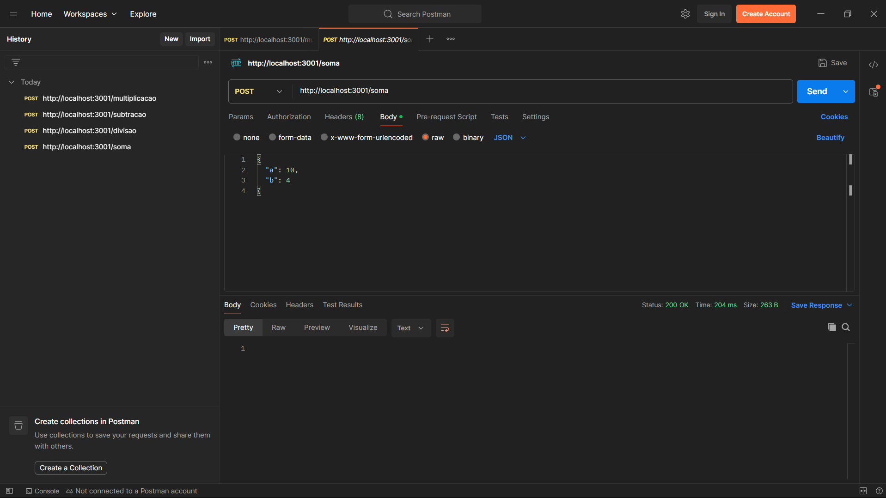
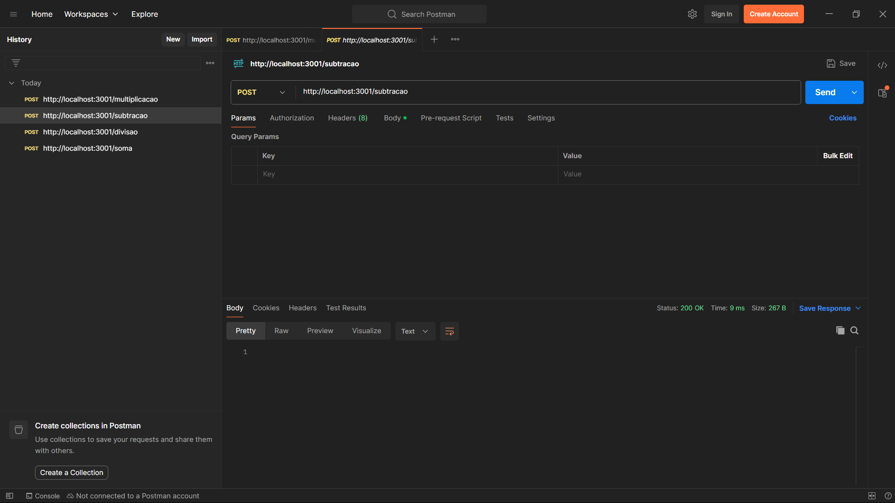
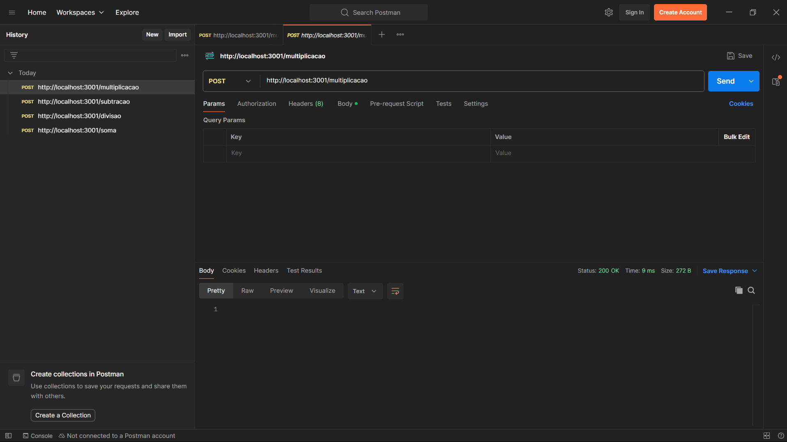

# site-soma

Aplicação web em Node.js com Express que recebe dois números via requisição POST e retorna o resultado de uma operação matemática.

## Tecnologias

- Node.js
- Express
- body-parser
- Postman (para testar as requisições)

## Como executar

```bash
npm install
node app.js
```

O servidor sobe em http://localhost:3001.

## Rotas

| Método | Rota | Descrição |
|---|---|---|
| GET | `/` | Mensagem de teste do servidor |
| POST | `/soma` | Soma os valores `a` e `b` |
| POST | `/subtracao` | Subtrai `b` de `a` |
| POST | `/multiplicacao` | Multiplica `a` por `b` |
| POST | `/divisao` | Divide `a` por `b` |

Todas as rotas POST recebem um JSON no corpo da requisição:

```json
{
  "a": 10,
  "b": 4
}
```

## Testes no Postman

### Soma



### Subtração



### Multiplicação



### Divisão

